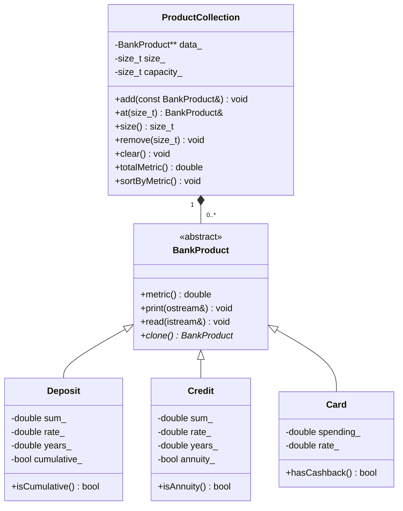

# Лабораторная работа 4

**Вариант 12. Мир E «Банк».** Сортировка коллекции `Deposit`, `Credit`, `Card` по `metric()`.

## Структура

`include/` — заголовки; `src/` — реализация и `main.cpp`;
`tests/bank_test.cpp` — 15 тестов Google Test; `CMakeLists.txt` — сборка.

## Контракт



`BankProduct` — абстрактный интерфейс. Чисто виртуальные методы:
`double metric() const`, `void print(std::ostream&) const`,
`void read(std::istream&)`, `BankProduct* clone() const` — их поведение зависит от типа продукта.
Виртуальный деструктор `= default` обеспечивает удаление наследников через базовый указатель.
Переопределения имеют `override`; запросы имеют `const`, так как не изменяют объект.
Копирование и перемещение продуктов стандартные: собственных ресурсов у них нет.

- `Deposit(sum, rate, years, cumulative)` — вклад; `isCumulative()` возвращает флаг капитализации.
- `Credit(sum, rate, years, annuity)` — кредит; `isAnnuity()` возвращает флаг аннуитета.
- `Card(spending, rate)` — карта; `hasCashback()` проверяет `rate > 0`.

Суммы и ставки конечны и неотрицательны, срок конечен и положителен.
По умолчанию суммы и ставки равны 0, срок — 1, флаги — `false`.
`metric()` вычисляется по формулам ТЗ. Ставка — доля (`0.1` = 10%),
кроме аннуитетного кредита: проценты (`12` = 12%). При его нулевой ставке метрика — `sum / years`.
Типовые методы вызываются после успешного `dynamic_cast`.

Свободные `<<` и `>>` делегируют `print` и `read` по ссылке без срезки.
`explicit operator double()` возвращает метрику;
`operator==` проверяет разность метрик по модулю меньше `1e-6`.

`ProductCollection` владеет собственным массивом `BankProduct**` и копиями объектов:
`add(const BankProduct&)` клонирует продукт, `size()` и `at(index)` обеспечивают обход,
`totalMetric()` считает сумму, `remove(index)` и `clear()` удаляют объекты.
Правило пяти: глубокое копирование, присваивание через copy-and-swap,
перемещение с опустошением источника, деструктор с удалением объектов и массива.
`sortByMetric()` сортирует указатели вставками по возрастанию метрики.

## Ввод и вывод

Ввод: `sum rate years cumulative` для вклада, `sum rate years annuity` для кредита,
`spending rate` для карты. Флаги: 0 — `false`, ненулевое целое — `true`.
Вывод — имя класса, поля и метрика, например:

```text
Deposit: sum=1000 rate=0.5 years=2 cumulative=1 metric=625
```

Полный вывод также принимается при чтении. При ошибке — `failbit`, объект не меняется.

## Сборка и запуск

C++20, CMake 3.20+, Google Test (из системы или через FetchContent).
Для GCC/Clang включены `-Wall -Wextra -Wpedantic`.
Из `~/oop_lab/lab4` в Ubuntu/WSL:

```bash
cmake -S . -B build -DCMAKE_BUILD_TYPE=Debug
cmake --build build -j 4
ctest --test-dir build --output-on-failure
./build/lab_04_main
./build/lab_04_main --interactive
```

Без аргументов — демонстрация; `--interactive` — ручной ввод, команда `help` — справка.
Проверка памяти в Linux с GCC/Clang:

```bash
cmake -S . -B build-asan -DCMAKE_BUILD_TYPE=Debug -DENABLE_SANITIZERS=ON
cmake --build build-asan -j 4
ASAN_OPTIONS=detect_leaks=1:halt_on_error=1 UBSAN_OPTIONS=halt_on_error=1 ./build-asan/lab_04_tests
```

Все 15 тестов проходят; ASan/LSan/UBSan ошибок и утечек не выявили.

## Чек-лист ТЗ

- [x] Абстрактный базовый класс.
- [x] Виртуальный деструктор.
- [x] Общие методы `virtual`, переопределения `override`.
- [x] Неизменяющие методы `const`.
- [x] Свободные `<<` и `>>` делегируют виртуальным методам.
- [x] Приведение к `double` возвращает метрику.
- [x] Равенство по метрике с `eps`.
- [x] Тип-специфичный метод у каждого наследника.
- [x] Коллекция базовых указателей с корректным удалением.
- [x] Владение описано.
- [x] Правило пяти для собственного массива.
- [x] Нет срезки объектов.
- [x] Форматы печати и чтения согласованы.
